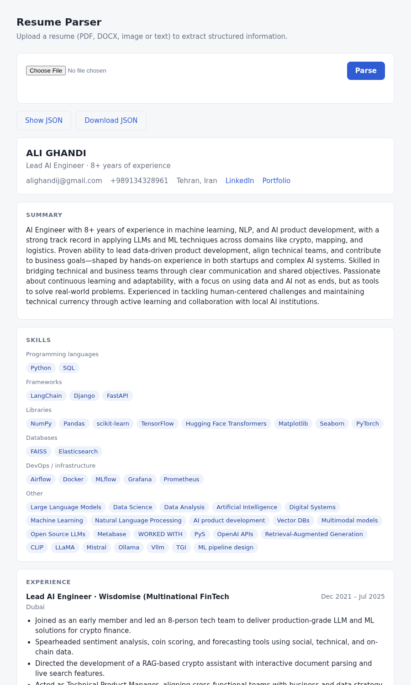

# Intelligent Resume Parser — Approach A (spaCy + classical ML)

Converts resumes in any common format into one fixed JSON structure. This project is the **traditional NLP / ML** implementation:

- **NER:** a spaCy CNN model trained on 248 annotated resumes.
- **Section classifier:** TF-IDF + Logistic Regression.
- **Skill matching:** character n-gram similarity.

The transformer implementation in `../resume_parser_transformer` shares every other file byte for byte, including the same output schema. The comparison of the two approaches is in [`evaluation/REPORT.md`](evaluation/REPORT.md).

| Held-out test (31 resumes) | Rules only | **This project** | Transformer |
|---|---:|---:|---:|
| Entity micro F1 (exact) | — | **0.494** | 0.633 |
| Document-level field score | 0.596 | **0.678** | 0.755 |
| NER time per resume | — | **~75 ms** (CPU) | ~0.2 s (GPU) / ~1–1.5 s (CPU) |

## Demo

The upload page (`uvicorn api.app:app`, then http://127.0.0.1:8000) showing the parsed `sample_output.json`:



## Pipeline

1. **Ingestion** (`preprocessing/ingest.py`):
   - PDF via PyMuPDF, with two-column reading-order recovery.
   - Scanned PDF pages and images (`.png .jpg .jpeg .tif .tiff .bmp .webp`) via Tesseract OCR.
   - DOCX via python-docx, reading paragraphs, tables and text boxes in document order.
   - `.txt .md .csv .tsv .xml .json .html .htm` as structured or plain text.
2. **Cleaning:** whitespace normalization, and re-joining words hyphenated at line breaks.
3. **Section detection** (`preprocessing/sections.py`): heading aliases → keyword rule → learned heading classifier (heading + 3 lines of context) → learned content classifier for headingless blocks.
4. **Entity extraction** (`inference/backend.py`): spaCy NER for PERSON, EMAIL, LOCATION, JOB_TITLE, COMPANY, SKILL, DATE, DEGREE and INSTITUTION. Email, phone and links use patterns.
5. **Skill normalization** (`preprocessing/normalize.py`): ontology of ~330 surface forms → canonical name, category and parent concepts; a char-n-gram semantic fallback; deduplication.
6. **Information mapping** (`inference/parser.py` and `inference/records.py`): splits experience, education and project records; computes total experience from dates; detects overlaps; adds per-field confidence and evidence.

## Project structure

```text
resume_parser_spacy/
|
├── data/              input/ (33 mixed-format resumes), extracted/ + 
|                      parsed/ (batch output), input_xml/ (310-resume 
|                      corpus)
|
├── annotations/       entity splits, section annotations, Label Studio 
|                      configs, annotation guide (README.md)
|
├── preprocessing/     ingest.py, sections.py, normalize.py
|
├── models/            resume_ner_spacy_vectors/ (NER),  
|                      section_classifier/
|
├── training/          train_spacy_ner.py, train_section_classifier.py, 
|                      split_*.py, Label Studio tools
|
├── inference/         parser.py (main flow), records.py (jobs, 
|                      education, projects), patterns.py (regexes),
│                      backend.py (Approach A models), cli.py
|
├── evaluation/        evaluate_ner.py, evaluate_sections.py, 
|                      evaluate_fields.py, results/, REPORT.md
|
├── api/               app.py (FastAPI) + static/index.html (upload 
|                      page)
|
├── schema.py          the output schema + a validator
|
├── batch_parse.py     parse every file in data/input
|
├── execute.ipynb      runbook: train → evaluate → batch
|
├── requirements.txt
|
└── sample_output.json
```

## Setup

Python 3.10+. Scans also need the Tesseract binary (`sudo apt install tesseract-ocr`).

```bash
python3 -m venv .venv && source .venv/bin/activate
pip install -r requirements.txt
```

The trained models are included in `models/`. To retrain from scratch, see [`training/README.md`](training/README.md).

## Use

```bash
python3 -m inference.cli data/input/CV_GhandiAli.pdf --output parsed.json   # one file
python3 -m inference.cli resume.pdf --no-model                               # rules + ontology baseline
python3 -m inference.cli resume.pdf --with-metadata                          # + confidence, evidence, sections
python3 batch_parse.py                                             # data/input → data/parsed
uvicorn api.app:app --reload                                                # web page: http://127.0.0.1:8000
```

The page at `/` lets you upload a resume and shows the result as readable sections, with buttons to view or download the JSON. For programmatic use, `POST /parse-resume` (documented at `/docs`) takes a file upload (25 MB max) and returns the JSON. `GET /health` reports which models loaded. To use other checkpoints, set `RESUME_PARSER_MODEL` and `RESUME_SECTION_MODEL`.

## Output

See [`sample_output.json`](sample_output.json). The schema is defined in [`schema.py`](schema.py) and is identical in both projects:

- `candidate`: `full_name`, `email`, `phone_number`, `location`, `linkedin`, `github`, `portfolio`
- `professional_information`: `professional_summary`, `career_objective`, `total_experience`, `current_or_most_recent_role`
- `skills`: `technical_skills`, `programming_languages`, `frameworks`, `libraries`, `databases`, `cloud_technologies`, `devops_infrastructure`, `tools`, `other_relevant_technologies`
- `education[]`: `degree`, `specialization`, `institution`, `start_year`, `end_year`, `grade`, `raw_text`
- `projects[]`: `name`, `summary`, `technology_stack`, `role`, `responsibilities`
- `work_experience[]`: `company`, `designation`, `location`, `start_date`, `end_date`, `responsibilities`, `technologies_used`, `raw_text`
- `certifications`, `achievements`, `volunteering`
- `extraction_metadata` (**only on request**: API `?include_metadata=true`, CLI/batch `--with-metadata`): detected sections (heading, method, confidence), `field_confidence`, `evidence`, `skill_normalization` (raw → normalized, category, ontology parents, source sections), `experience_analysis` (total from dates, overlapping and duplicate entries), and the loaded components

Missing values are `null` or `[]`. By default the output contains only the schema fields; `sample_output_with_metadata.json` shows the extra block.

Shared code is kept identical in both projects: edit it in `resume_parser_spacy/`, then run `../sync_shared.sh`.

## Evaluate

```bash
python3 evaluation/evaluate_ner.py && python3 evaluation/evaluate_sections.py && python3 evaluation/evaluate_fields.py
```

## Limitations

Measured accuracy is on the XML-derived corpus; behaviour on PDFs, DOCX and scans is shown on `data/input` but not scored. Confidence values are uncalibrated priors. Treat output as a draft for review. See §6–8 of the report.

Resume data contains personal information. Keep the repository private, and check consent and licensing before sharing raw resumes.
